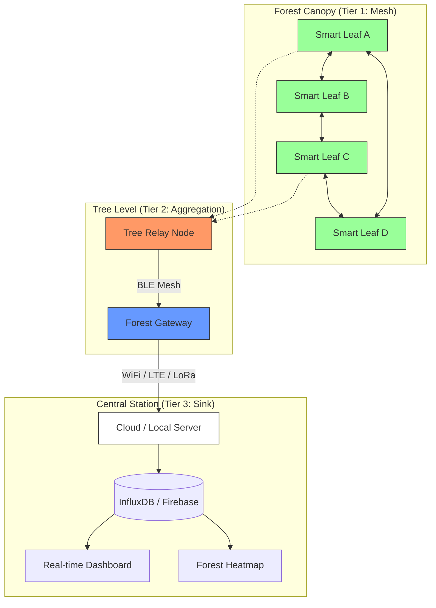

# Communication Protocol Comparison & Forest Monitoring Architecture

## 1. Bluetooth Mesh vs. LoRaWAN Comparison

| Feature | Bluetooth Mesh (BLE) | LoRaWAN |
| :--- | :--- | :--- |
| **Network Topology** | **Multi-hop Mesh:** Data "hops" from leaf to leaf to reach a gateway. | **Star of Stars:** Every leaf talks directly to a central gateway/tower. |
| **Range (Per Link)** | Short (~10–100 meters). Optimized for proximity. | Long (2–15 km). Optimized for wide-area coverage. |
| **Data Rate** | **High** (~125 kbps – 2 Mbps). Supports frequent/rich sensor data. | **Low** (0.3 kbps – 50 kbps). Best for small, infrequent status updates. |
| **Power Consumption** | **Ultra-Low:** Nodes must relay data, but modern "Friend/Low-Power" nodes optimize this. | **Extremely Low:** Nodes spend most of their time in deep sleep; no relaying duty. |
| **Node Density** | **Very High:** Supports up to 32,767 nodes; thrives in dense "leaf-to-leaf" clusters. | **Moderate:** Gateway capacity can become a bottleneck in ultra-dense urban deployments. |
| **Self-Healing** | **Yes:** If one "leaf" dies, the mesh automatically reroutes data through others. | **No:** If a leaf loses its direct link to the gateway, the data is lost. |
| **Hardware / Antenna** | 2.4 GHz. Compact fractal antennas are easier to design for smaller footprints. | Sub-GHz (868/915 MHz). Requires physically larger antennas (challenging for "leaf" size). |
| **Best For...** | **Dense Canopies / Urban Parks:** Where nodes are close together and redundancy is key. | **Remote / Sparse Areas:** Where a single gateway covers an entire forest or farm. |

## 2. Centralized Data Collection in Forest Environments

To collect data from a forest where every tree has several sensors (Smart Leaves), a **Multi-Tiered Gateway Architecture** is proposed for the Bluetooth Mesh implementation.

### Conceptual Architecture Diagram

### Tiered Architecture
1.  **Tier 1: Leaf-to-Leaf (The Mesh)**
    - All leaves on a tree and neighboring trees form a mesh.
    - They "gossip" data to each other using the BLE Mesh Managed Flooding protocol.
    - Each leaf is assigned a unique **Unicast Address** (e.g., `Tree_01_Leaf_A`).

2.  **Tier 2: The Tree Gateway (The Edge Node)**
    - On each tree (or every few trees), a slightly more powerful "Relay Node" is placed (hidden in the trunk or a birdhouse).
    - This node acts as a local aggregator and ensures data reach across larger distances within the forest.

3.  **Tier 3: The Forest Gateway (The Sink)**
    - A single central station (or a few spread out) acts as a **BLE-to-WiFi/LTE/LoRa bridge**.
    - It listens to the mesh, collects all "leaf packets," and uploads them to a centralized database (Cloud or Local Server).

## 3. Technical Design Priorities & Research Integration

Based on the **GradProj1_Communication** roadmap, the following technical strategies are prioritized for the V-OSEM implementation:

### 3.1 Network Resilience (WiLe Protocol)
- **Status:** **High Priority / Important**
- **Integration:** We will implement the **WiLe (Fault Tolerance Mesh)** logic. Unlike standard flooding, WiLe ensures reliable data delivery even if intermediate "Smart Leaves" fail or are blocked by dense foliage. This is critical for maintaining the mesh integrity in harsh forest environments.

### 3.2 Power & Autonomy (Darroudi Energy Model)
- **Status:** **In Progress**
- **Integration:** The **Darroudi (2023)** energy consumption models will be used to calibrate our **Power Budget Modeling**. We will analyze the per-packet energy cost to ensure that our hybrid TENG/TOPV harvesting provides sufficient energy for 24/7 autonomous sensing and multi-hop relaying.

### 3.3 Routing Optimization (BOM Overlay)
- **Status:** **In Progress**
- **Integration:** We are evaluating the **BLE-Based Overlay Mesh (BOM)** approach. This may replace standard "Managed Flooding" to reduce redundant transmissions and further extend the battery life of the Tier-1 leaf nodes.

### 3.4 Design Scope Exclusions
- **Link Prediction for Mobility:** **Out of Scope / Red.** Since the Smart Leaf nodes are physically attached to trees (static), complex link prediction algorithms designed for mobile nodes (e.g., LPMA) are excluded to minimize computational overhead on the local processing unit.

## 4. Data Representation & Visualization
Once collected at the central gateway, the data can be represented using various methods:

| Method | Application | Tools |
| :--- | :--- | :--- |
| **Heatmap Overlay** | Visualizing pollution or UV intensity across the forest floor/canopy. | Grafana + Leaflet.js |
| **Digital Twin** | Creating a 3D model of the forest where each tree's health is color-coded. | Unity or Three.js |
| **Real-time Dashboard** | Monitoring battery levels and sensor health (voltage, current from TIA). | ThingsBoard or Adafruit IO |
| **Time-Series Graphs** | Analyzing trends (e.g., UV changes during a rainstorm). | InfluxDB + Chronograf |
